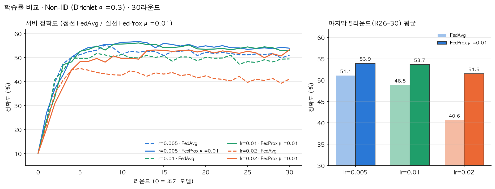
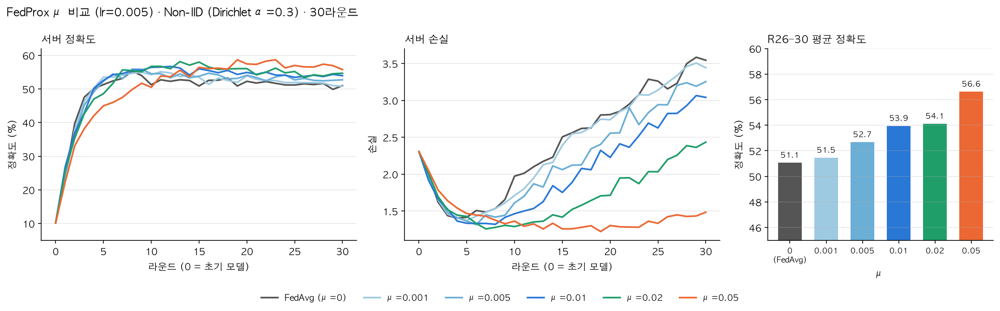

# 30라운드 스윕: 학습률 × FedProx μ (Non-IID)

10라운드 비교(FedAvg 52.38% vs FedProx μ=0.01 54.97%)를 라운드 30회로 늘려 다시 확인하고, 학습률과 μ를 함께 조정한 실험이다.

## 설정
- 데이터·모델: CIFAR-10, Dirichlet α=0.3(seed 42)로 2분할, 작은 CNN, SGD(momentum 0.9), batch 32, local epoch 3. 10라운드 실험과 같다.
- 라운드: 30, 매 라운드 노드 2개 전원 참여
- 실행 환경: Oracle Cloud A1(ARM 2코어) 한 대에서 SuperLink와 SuperNode 2개(partition 0/1)를 함께 실행 (`start_fl.sh`, `sweep_oci.py`)
- 1단계: 학습률 0.005 / 0.01 / 0.02 × {FedAvg, FedProx μ=0.01}
- 2단계: 1단계에서 두 전략의 R26–30 평균이 가장 높은 학습률(0.005)로 μ = 0.001 / 0.005 / 0.02 / 0.05
- 모든 실행의 0라운드 정확도가 10.2%로 같다 (같은 초기 가중치)
- 실행당 약 50분, 10개 실행 모두 `error in reply` 0건

## 결과 (서버 전역 평가, CIFAR-10 test 10,000장)

### 1단계: 학습률



| 학습률 | 전략 | 최종 (R30) | 최고 | R26–30 평균 | 최고 대비 하락 |
|---|---|---|---|---|---|
| 0.005 | FedAvg | 50.98% | 55.31% (R8) | 51.06% | −4.25%p |
| 0.005 | FedProx μ=0.01 | 53.93% | 56.69% (R12) | **53.95%** | −2.74%p |
| 0.01 | FedAvg | 49.45% | 51.77% (R7) | 48.83% | −2.94%p |
| 0.01 | FedProx μ=0.01 | 52.97% | 56.12% (R12) | 53.66% | −2.46%p |
| 0.02 | FedAvg | 41.08% | 45.46% (R5) | 40.63% | −4.83%p |
| 0.02 | FedProx μ=0.01 | 53.30% | 53.30% (R30) | 51.51% | −1.79%p |

### 2단계: μ (lr=0.005)



| μ | 최종 (R30) | 최고 | R26–30 평균 ± 표준편차 | 50% 도달 | 최저 손실 → 최종 손실 상승 |
|---|---|---|---|---|---|
| 0 (FedAvg) | 50.98% | 55.31% (R8) | 51.06 ± 0.64% | R4 | +152% |
| 0.001 | 50.81% | 55.12% (R11) | 51.45 ± 0.46% | R4 | +151% |
| 0.005 | 52.71% | 55.91% (R8) | 52.67 ± 0.25% | R5 | +147% |
| 0.01 | 53.93% | 56.69% (R12) | 53.95 ± 0.24% | R4 | +130% |
| 0.02 | 54.66% | 58.12% (R13) | 54.11 ± 0.48% | R6 | +94% |
| **0.05** | **55.76%** | **58.68% (R23)** | **56.62 ± 0.53%** | R9 | **+22%** |

## 해석
- **FedAvg의 drift가 30라운드에서는 정확도 하락으로 이어졌다.** lr=0.005 FedAvg는 8라운드에 55.31%로 정점을 찍은 뒤 마지막 5라운드 평균이 51.06%로 4.25%p 떨어졌다. 서버 손실은 최저점(R4)보다 152% 올랐다. 10라운드 실험에서 보였던 손실 상승 신호가 라운드를 늘리자 실제 성능 저하로 나타났다.
- **같은 학습률에서 FedProx(μ=0.01)가 항상 FedAvg보다 높았다** (R26–30 평균 +2.9 / +4.8 / +10.9%p). 학습률을 키우면 FedAvg는 크게 떨어지지만(51.1 → 48.8 → 40.6%) FedProx는 51.5–54.0%를 유지했다. 근접항이 큰 학습률에서 로컬 모델이 멀리 벗어나는 것을 막아 준 것으로 보인다.
- **30라운드에서는 최적 μ가 커졌다.** lr=0.005에서 μ를 0 → 0.05로 키울수록 마지막 5라운드 평균이 단조롭게 올랐다(51.1 → 56.6%). μ=0.05는 초반이 느려 50% 도달이 R9로 가장 늦었지만, 손실 상승이 22%로 가장 작고 최종 정확도가 가장 높았다. 10라운드에서는 μ=0.1이 너무 강했는데, 라운드가 길면 초반 속도보다 drift 억제가 더 중요해져 더 큰 μ가 유리해진다. 즉 **좋은 μ는 라운드 예산에 따라 달라진다.**
- 0.05보다 큰 μ(0.1 등)는 30라운드에서 시험하지 않았으므로, 최적점이 0.05인지 그 위인지는 아직 모른다.

## 한계
- 조건마다 시드 1회 실행이다. 1–2%p 차이는 우연일 수 있다. 다만 μ에 따른 단조 증가와 큰 학습률에서 FedAvg의 급락은 일관된 경향이다.
- 학습률을 고를 때도 같은 test 셋(R26–30 평균)을 썼다. 별도 검증 셋이 없으므로 2단계 수치는 약간 낙관적일 수 있다.
- 노드 2개를 한 서버에서 돌렸다. 통신 지연이 사실상 없고, 10라운드 실험(맥·데스크탑 노드)과는 하드웨어가 달라 숫자를 직접 비교하지 않는다. 예를 들어 같은 설정(lr=0.01 FedAvg)의 10라운드 정확도가 이번에는 51.37%, 이전 실험에서는 52.38%였다.

## 다음 실험
- 시드 3개 이상으로 FedAvg / μ=0.01 / μ=0.05 반복
- μ = 0.1, 0.2를 30라운드에서 추가해 최적점 확인
- 검증 셋을 분리해서 하이퍼파라미터 선택과 최종 평가를 나누기

## 재현
```bash
# Oracle 서버에서
~/start_fl.sh                                   # SuperLink + SuperNode 2개
cd ~/fedcompare_src && nohup python sweep_oci.py &   # 10개 실행, 진행: ~/NonIID/sweep30/progress.txt
# 맥에서
python plot_sweep30.py                          # results/sweep30/*.json → report/sweep30_*.png
```
원자료: `results/sweep30/*.json`, 로그: `logs/sweep30/`
