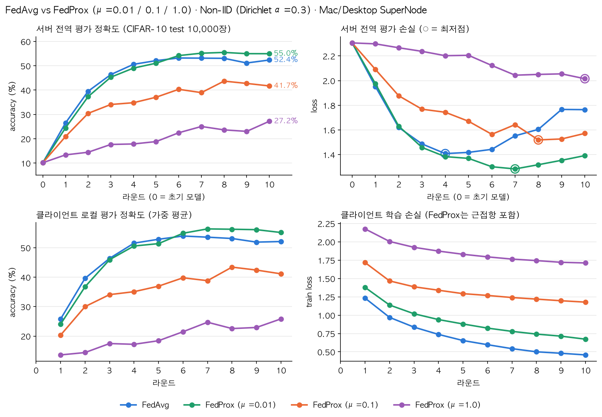

# Federated Learning Experiments

[Flower](https://flower.ai/)와 PyTorch로 진행한 연합학습 실험 모음입니다.

## 구성

| 폴더 | 내용 |
| --- | --- |
| [`quickstart-pytorch/`](quickstart-pytorch/) | Flower PyTorch quickstart 기반 실행 코드와 실행 결과 |
| [`FedProx/`](FedProx/) | FedProx 구현, FedAvg와의 비교 스크립트, 분산 실행 로그와 결과 |
| [`NonIID/`](NonIID/) | Non-IID 환경의 FedAvg vs FedProx(μ=0.01/0.1/1.0) 비교 실험, 로그, 결과, [보고서 PDF](NonIID/report/FedAvg_vs_FedProx_NonIID_보고서.pdf) |
| [`results/`](results/) | 실행 결과 텍스트 |

## 실행 환경 준비

각 실험 폴더는 독립된 Flower 앱이며, 의존성은 폴더별 `pyproject.toml`에 정의되어 있습니다.

```bash
python -m venv .venv
source .venv/bin/activate
pip install -e NonIID   # 실행할 실험 폴더 지정
```

## 주요 결과: Non-IID (Dirichlet α=0.3, 클라이언트 2개, 10라운드)

| 전략 | 최종 정확도 | 최고 정확도 | 최저점 대비 손실 상승 |
| --- | --- | --- | --- |
| FedAvg | 52.38% | 53.21% (R6) | +25.3% |
| **FedProx μ=0.01** | **54.97%** | **55.50% (R8)** | +8.4% |
| FedProx μ=0.1 | 41.72% | 43.70% (R8) | +3.5% |
| FedProx μ=1.0 | 27.20% | 27.20% (R10) | 0% (아직 감소 중) |

근접항을 약하게(μ=0.01) 줄 때만 FedAvg보다 정확도와 안정성이 모두 좋았고, μ가 커질수록 학습이 느려졌습니다. 조건별 시드 1회 실행 결과입니다. 자세한 내용은 [보고서](NonIID/report/FedAvg_vs_FedProx_NonIID_보고서.pdf)를 참고하세요.


