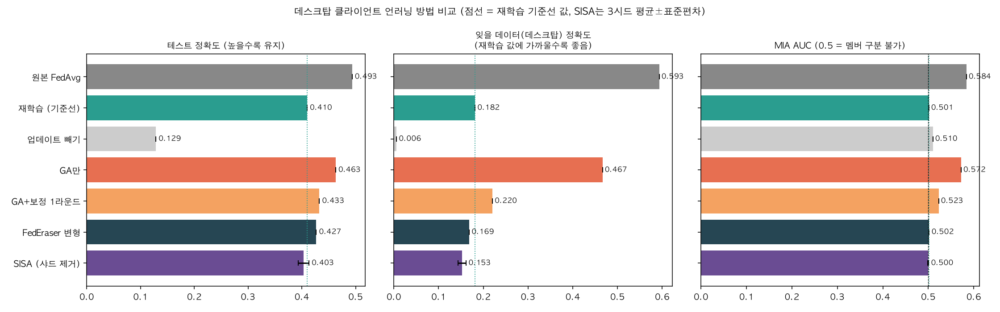
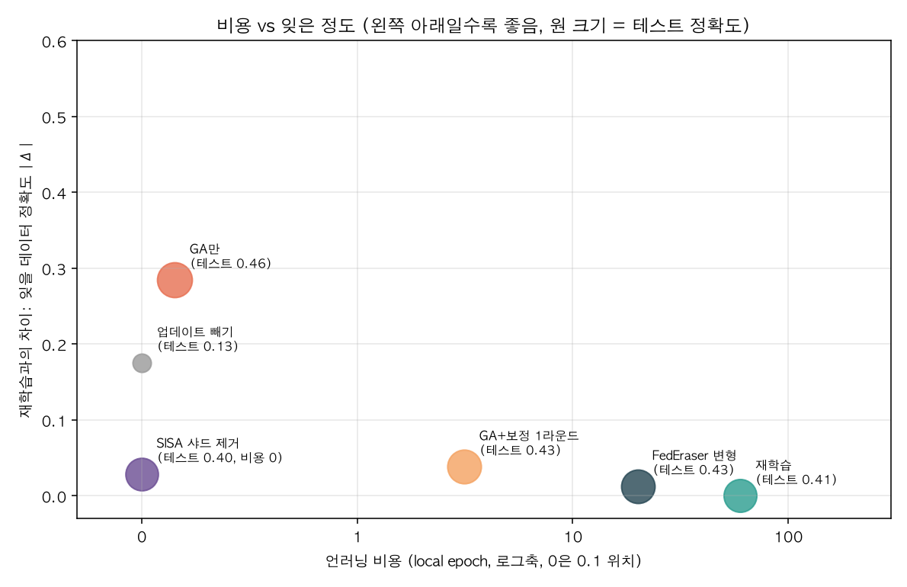
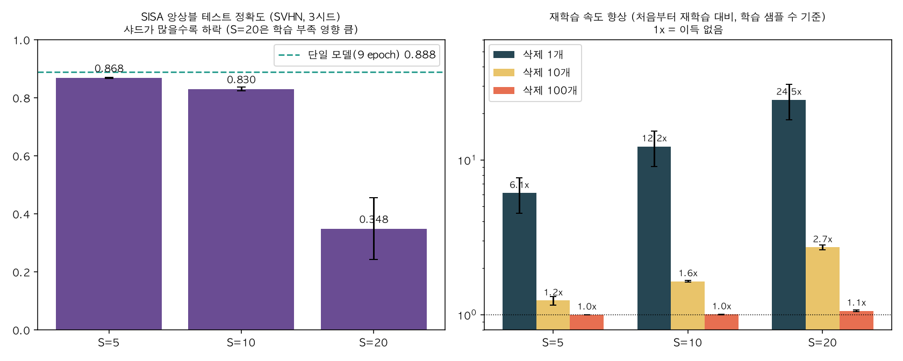
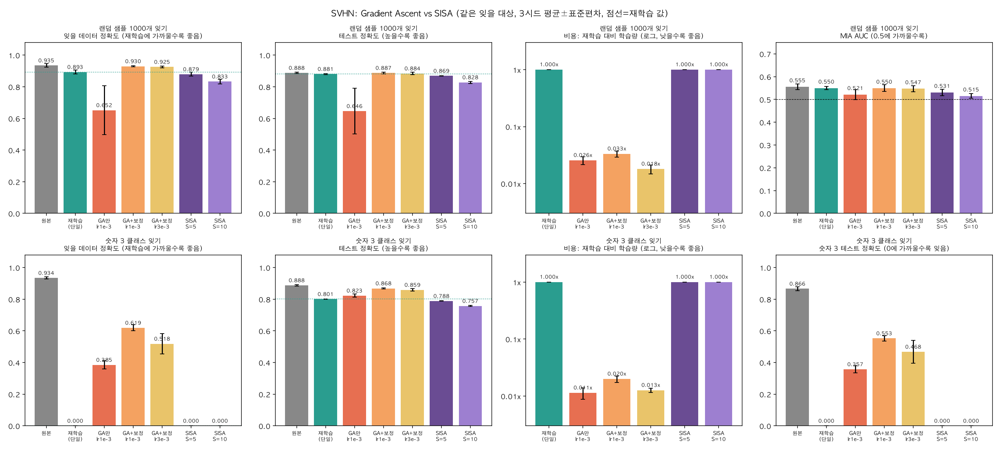
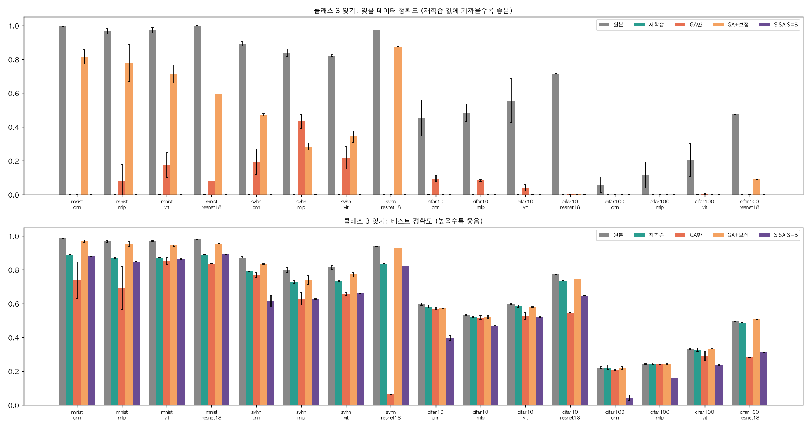

# Federated Learning & Machine Unlearning Experiments

[Flower](https://flower.ai/)와 PyTorch로 진행한 연합학습 및 머신 언러닝(Gradient Ascent, FedEraser, SISA) 실험 모음입니다.

## 구성

| 폴더 | 내용 |
| --- | --- |
| [`quickstart-pytorch/`](quickstart-pytorch/) | Flower PyTorch quickstart 기반 실행 코드와 실행 결과 |
| [`FedProx/`](FedProx/) | FedProx 구현, FedAvg와의 비교 스크립트, 분산 실행 로그와 결과 |
| [`NonIID/`](NonIID/) | Non-IID 환경의 FedAvg vs FedProx(μ=0.01/0.1/1.0) 비교 실험, 로그, 결과, [보고서 PDF](NonIID/report/FedAvg_vs_FedProx_NonIID_보고서.pdf) |
| [`results/`](results/) | 실행 결과 텍스트 |

## 실행 환경 준비

각 실험 폴더는 독립된 Flower 앱이며, 의존성은 폴더별 `pyproject.toml`에 정의되어 있습니다.

```bash
python -m venv .venv
source .venv/bin/activate
pip install -e NonIID   # 실행할 실험 폴더 지정
```

## 주요 결과: Non-IID (Dirichlet α=0.3, 클라이언트 2개, 10라운드)

| 전략 | 최종 정확도 | 최고 정확도 | 최저점 대비 손실 상승 |
| --- | --- | --- | --- |
| FedAvg | 52.38% | 53.21% (R6) | +25.3% |
| **FedProx μ=0.01** | **54.97%** | **55.50% (R8)** | +8.4% |
| FedProx μ=0.1 | 41.72% | 43.70% (R8) | +3.5% |
| FedProx μ=1.0 | 27.20% | 27.20% (R10) | 0% (아직 감소 중) |

근접항을 약하게(μ=0.01) 줄 때만 FedAvg보다 정확도와 안정성이 모두 좋았고, μ가 커질수록 학습이 느려졌습니다. 조건별 시드 1회 실행 결과입니다. 자세한 내용은 [보고서](NonIID/report/FedAvg_vs_FedProx_NonIID_보고서.pdf)를 참고하세요.


## 주요 결과 2: 30라운드 · 학습률 × μ 스윕

| 설정 (lr=0.005) | 최종 (R30) | 최고 | R26–30 평균 |
| --- | --- | --- | --- |
| FedAvg | 50.98% | 55.31% (R8) | 51.06% |
| FedProx μ=0.01 | 53.93% | 56.69% (R12) | 53.95% |
| FedProx μ=0.02 | 54.66% | 58.12% (R13) | 54.11% |
| **FedProx μ=0.05** | **55.76%** | **58.68% (R23)** | **56.62%** |

라운드를 30회로 늘리자 FedAvg는 8라운드 정점 이후 4.3%p 떨어졌고(client drift), FedProx는 μ를 키울수록(0.001 → 0.05) 마지막 정확도가 올랐습니다. 학습률을 0.02로 키우면 FedAvg는 40.6%까지 떨어졌지만 FedProx(μ=0.01)는 51.5%를 유지했습니다. 10라운드에서는 μ=0.01이 최선이었으므로, 좋은 μ는 라운드 예산에 따라 달라집니다. 시드 1회 실행 결과이며, 자세한 표와 한계는 [SWEEP30.md](NonIID/SWEEP30.md)에 있습니다.


## 주요 결과 3: 클라이언트 언러닝 (데스크탑 클라이언트 잊기)

같은 설정(CIFAR-10, Dirichlet α=0.3, 클라이언트 2개)에서 데스크탑 클라이언트를 모델에서 지우는 방법을 비교했다. 기준선은 Mac만으로 처음부터 다시 학습한 모델. 자세한 내용은 [`Unlearning/README.md`](Unlearning/README.md).





| 방법 | 테스트 정확도 | 데스크탑 데이터 정확도 | MIA AUC | 재학습 비용 (local epoch) |
|---|---|---|---|---|
| 원본 FedAvg | 0.493 | 0.593 | 0.584 | 120 |
| 재학습 (기준선) | 0.410 | 0.182 | 0.501 | 60 |
| Gradient ascent + 보정 1라운드 | 0.433 | 0.220 | 0.523 | 3.1 |
| FedEraser 변형 (α=0.25) | 0.427 | 0.169 | 0.502 | 20 |
| SISA (샤드=클라이언트, 샤드 제거, 3시드 평균) | 0.403 | 0.153 | 0.500 | 0 |

Gradient ascent만 쓰면 모델이 붕괴하거나 거의 잊지 못하고, 원본 FedEraser는 라벨 편향에서 발산한다. 단일 시드(SISA만 3시드), 클라이언트 2개 설정이라는 한계가 있다.

## 주요 결과 4: SISA on SVHN (논문 데이터셋)

SISA 논문(Bourtoule et al.)이 쓴 SVHN으로 샤드 수(5/10/20)별 정확도와 삭제 후 재학습 비용을 비교했다 (맥북, 3시드). 자세한 내용은 [`Unlearning/README.md`](Unlearning/README.md).



샘플 1개 삭제는 샤드 수가 많을수록 빨라지지만(최대 약 24배) 10개 이상이면 대부분의 샤드가 걸려 이득이 사라진다. 샤드가 많을수록 앙상블 정확도는 내려가며, S=20의 큰 하락은 샤드당 학습량 부족 때문이었다(epoch 10으로 늘리면 0.857).

## 주요 결과 5: SVHN에서 Gradient Ascent vs SISA

SVHN과 같은 작은 CNN으로 gradient ascent(GA)를 돌리고, 같은 잊을 대상(랜덤 1000개 / 숫자 3 클래스)과 지표로 SISA와 비교했다 (맥북, 3시드). 자세한 내용은 [`Unlearning/README.md`](Unlearning/README.md).



GA는 재학습의 1–3% 비용으로 일부만 잊고(숫자 3 정확도 0.87 → 0.36–0.55, 재학습은 0.00), 보정하면 모델은 회복되지만 잊은 내용도 되살아난다. SISA는 정확하게 잊지만(0.00) 샤드를 랜덤으로 나눠서 모든 샤드가 걸려 비용이 재학습과 같고, 앙상블 정확도가 조금 낮다.

## 주요 결과 6: 데이터셋 4개 × 모델 4개 언러닝 비교

MNIST / SVHN / CIFAR-10 / CIFAR-100 와 작은 CNN / MLP / ResNet-18 / 작은 ViT 16조합에서 같은 레시피(6 epoch)로 재학습, GA, GA+보정, SISA(샤드 5개)를 비교했다 (클래스 3 잊기, 랜덤 1000개 잊기). CNN·MLP·ViT는 3시드, ResNet-18은 1시드. 자세한 내용은 [`Unlearning/multi/README.md`](Unlearning/multi/README.md), 전체 표는 [`summary.md`](Unlearning/multi/summary.md).



SISA는 모든 조합에서 정확하게 잊지만 비용은 재학습과 같고 앙상블 정확도가 낮다. GA는 재학습의 1–4% 비용이지만 모델이 손상되고(ResNet-18에서 특히 심함), 보정하면 성능은 회복되지만 잊은 내용도 되살아난다. CIFAR 계열에서는 원본이 해당 클래스를 원래 잘 못 맞혀서 "잊음" 해석이 약하다.

## 주요 결과 7: EECC 지표로 본 GA / GA+보정 / SISA

SISA 논문(Mercuri et al.) 3장의 평가 기준 EECC(Efficiency, Effectiveness, Consistency, Certifiability)를 재학습 모델 대비로 계산했다. CNN·MLP는 Consistency까지 3시드, ViT·ResNet-18은 Consistency 없이 계산했다. 표와 해석은 [`Unlearning/multi/README.md`](Unlearning/multi/README.md)의 EECC 절, [`eecc_cnn_mlp.md`](Unlearning/multi/eecc_cnn_mlp.md).

GA는 시간 기준 재학습의 1/12–1/200이지만 재학습 모델과의 예측 차이가 크고(랜덤 잊기 KL≈3), GA+보정은 Effectiveness가 가장 작으나 클래스 잊기에서 Certifiability(SAPE)가 50–58%라 잊은 데이터 정보가 남는다. SISA는 클래스 잊기에서 Certifiability 0이지만 이 설정에서는 Efficiency 이득이 없다.
